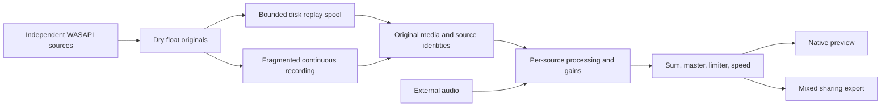

# Independent audio tracks

The Windows capture source now retains **dry, independent float audio** for
replay clips and continuous/manual recordings. Select **Each program as its
own track** in Audio settings for per-program capture. Existing source-mode
preferences are preserved. Rebuild the Windows capture engine and playback
mixer before using the changed capture behavior; an old executable cannot
produce the new originals. Full build instructions are in [BUILDING.md](../BUILDING.md).

The viewer provides per-source volume, mute and removal, external audio imports,
undo/redo and saved drafts. Removing a source changes the edit, preserving the
original file. Imports reference local files and start at clip time zero. They
follow trims, kept segments, seeking, speed and pitch changes. Short imports
end in silence without shortening video. Missing imports must be restored or
removed before export.

## Signal path and quality



- The canonical capture format remains **48 kHz stereo**. The stored codec is
  `pcm_f32le`: samples are preserved exactly after Windows capture and format
  conversion, including values above full scale and partial final packets.
  This is not a claim of bit-perfect access to an application's original
  media, microphone ADC or multichannel signal before Windows mixing/resampling.
  Raw packets are emitted on each capture callback, without accumulating an
  AAC-sized frame or hiding final samples until recording shutdown.
- Microphone gain and mono preferences are metadata. They are applied to a
  derived signal during preview/export; the recorded microphone remains dry
  stereo. A captured gain of zero is an initial mute that can be explicitly
  undone in the viewer. Future noise suppression, EQ and gates belong in this per-source
  processing stage. No noise-suppression model is included in this change.
- New clips use direct application summing. Muting an application never
  subtracts separately encoded audio from a system recording. Existing legacy
  delta manifests retain their interpretation; their old lossy stems cannot
  be repaired retroactively.
- The complete **selected-device** mix remains a switchable backup. It starts
  muted when application tracks exist. Enabling it replaces application
  summing, while microphone and imported tracks remain independent. With no
  application tracks, system audio remains audible by default.
- Preview and export consume the same validated source-processing and master
  filter descriptions from `FTHR_UI/core/audio_processing.py`. Summing has no
  source-count normalization. Source/master gain edits use 5 ms ramps and
  preserve decoder, seek and output-buffer state. The Python audio queue is
  bounded to 50 ms and requests a 40 ms endpoint buffer; actual device latency
  still depends on the Windows/Qt backend.
- An optional, default-enabled FFmpeg `alimiter` protects the final mix at
  0.98 full scale. Automatic level makeup is disabled. Its 5 ms lookahead is
  compensated and drained at EOF. Turning it off leaves final full-scale
  clipping protection; the peak indicator exposes overload. Reduce source
  levels or MASTER for clean output. Original tracks are unaffected by either
  choice. Limiter state participates in draft persistence and undo/redo.
- Time stretching runs once on the mixed result. Source graphs reset on seek
  and drain at EOF. Resampler delay is accounted for, including 44.1 kHz
  imports. Native PCM ends at the actual last sample rather than padding a
  final decoder block.
- Sharing/export renders compatible mixed AAC once from the selected sources.
  Sharing is lossy; originals remain float. Rendered output clears capture
  processing metadata to prevent microphone gain/mono being applied twice.
  A mix with processing or limiter enabled cannot use an unchanged-original
  upload shortcut.

## Replay storage and recording

Replay audio uses temporary 4 MiB disk chunks. Audio callbacks enqueue immutable
packets; a worker performs disk I/O. Snapshots share payload/chunk ownership and
read one packet at a time during muxing, avoiding a second full-history PCM
copy. Exact all-zero audio uses sparse in-memory extents and adjacent silence
is coalesced, preserving exact samples without writing zeros to disk.

The pending queue is bounded to 4 MiB per source. Actual retained disk payload
has a **4 GiB aggregate budget**, including snapshots still being saved. A spool
failure or exhausted budget makes that replay source unavailable explicitly;
it does not silently publish a truncated history. Restart capture after fixing
the resource problem. Continuous recordings have a separate bounded write queue
and receive raw packets independently of replay-spool success. Temporary files
use private, non-shared Windows handles and are deleted on last close.

Float audio costs 384,000 bytes/second per stereo source: approximately 23 MB
per minute before video, including each backup/microphone source. The 4 GiB
budget is a deliberate bound, not unlimited retention for arbitrarily many
active sources.

Continuous recording preallocates 38 PCM track slots because an MP4 header
cannot add arbitrary streams after writing starts. New programs can join an
existing recording without re-encoding or remuxing the full file. Slots are
assigned to stable source UUIDs; packet timestamps use the common recording
clock, preserving late starts. A microphone joining at 0.3 seconds stays at
0.3 seconds.

After each complete fragment, source identities and sample boundaries are
published into fixed-size reserved handler fields. The owned MP4 header helper
validates atom boundaries and changes only reserved header bytes. At successful
stop, unused audio `trak`/`trex` atoms become same-size `free` atoms; sample data,
track IDs and fragment offsets remain unchanged. A crashed recording exposes
only sources with committed samples. Reserved slots are hidden during probing,
while their actual audio ordinals are still counted correctly.

Self-contained `FTHR3` handlers contain UUID, type, default gain/mono,
`first_sample:last_sample` on the 48 kHz clip timeline, and a friendly name.
The earlier `FTHR2` format is also readable. First/last boundaries stop the
shared demuxer reading minutes ahead for late or ended sources. Source filters
and codec buffers are drained when a known source ends. Replay clips also keep
the existing SHA-256-bound, transactionally published manifest, extended with
codec, processing defaults and capture warnings. Continuous recordings need
no full-file hash/rewrite at stop to recover their source identities.

## Source grouping and limits

Windows INCLUDE process loopback includes descendants. Candidate roots are
coalesced into disjoint process trees, so parent/child audio is not summed twice.
Nested sources are identified as a group in the label. They cannot all be
isolated individually with this capture mode. The previous owner is retired
before its replacement is activated. The first nonzero activity block can
admit a source, and an active session is kept while digitally silent. Capture
cannot recover a program's first sound before its WASAPI client was started;
the selected-device backup is useful for these discovery/startup gaps.

| Bound | Current behavior |
| --- | --- |
| Program sources | 32 retained groups per capture generation |
| Total native audio tracks | 38: system, microphone, four devices, 32 program groups |
| External editor imports | Eight streams |
| Replay spool | 4 GiB aggregate payload; 4 MiB pending per source |
| Manual recording slots | 38; source-limit failure preserves completed fragments |
| Process-loopback availability | Windows build 20348 or later |
| Linux per-application capture | Not implemented by this change |

Replay manifests retain microphone, system, application and capacity failure
codes even when no audio source could be saved. The viewer displays capture
warnings rather than inventing a successful source. A backup cannot make
uncaptured sources individually editable. More than 32 independent groups,
unlimited retention and individual parent/child isolation are not promised.

## Validation and remaining qualification

`tools/build_audio_validation.py` reproducibly builds the playback DLL and
portable native checks with Zig 0.14.1 and the repository-pinned FFmpeg runtime.
Zig is a developer-only prerequisite, outside application runtime locks.

```powershell
.venv\Scripts\python.exe tools/build_audio_validation.py
# Optional: compile Windows microphone, process-loopback and registry modules too.
.venv\Scripts\python.exe tools/build_audio_validation.py --check-providers
$env:FTHR_PLAYBACK_TEST_DLL=(Resolve-Path FTHRcapture/FTHRPlaybackMixer/x64/Release/FTHRPlaybackMixer.dll).Path
.venv\Scripts\python.exe -m pytest tests/test_audio_quality_pipeline.py tests/test_multiband_audio.py tests/test_ffmpeg_playback_origin.py
```

Validation includes exact float/partial-tail preservation, snapshot lifetime
after ring destruction, disk cleanup, sparse silence, resource exhaustion,
disjoint process trees, ramp continuity, dry microphone recovery, preview vs
export overload behavior with/without the limiter, native late-source timing,
crash recovery, bounded decoder lookahead across late/ended sources, source
identity validation, import synchronization, original hashes, editor history,
drafts, removal, stale callbacks and upload/export contracts. Eight signal tests
compare native speed/pitch processing against the export graph. The existing native
AAC recording, seeking, unfinished-fragment and transactional-manifest suites
also run through `audio_regression.exe`.

The final local audio/editor/settings/upload run passed **200 tests without
skips**, with two existing Qt mouse-event deprecation warnings. Ruff
passed for the changed Python files. Playback and portable audio/writer code
were compiled and exercised against the pinned runtime.
The microphone, process-loopback and session-registry translation units were
also compiled. The optional provider check downloads one checksum-pinned
[Microsoft SDK activation header](https://github.com/microsoft/win32metadata/blob/9cf94833626504b330c2f616ce71a2d3497cdc76/generation/WinSDK/RecompiledIdlHeaders/um/audioclientactivationparams.h)
into the local validation cache to supplement Zig's Windows headers.

**The complete capture engine has not been built with MSVC/Windows SDK here.**
Physical Windows qualification remains required for microphone/game isolation,
device changes, process restarts, nested process trees, long capture sessions,
resource exhaustion and A/V synchronization. These checks cannot be replaced
by synthetic signal tests.

Primary references: [Microsoft application loopback sample](https://learn.microsoft.com/en-us/samples/microsoft/windows-classic-samples/applicationloopbackaudio-sample/),
[Microsoft process-loopback modes](https://learn.microsoft.com/en-us/windows/win32/api/audioclientactivationparams/ne-audioclientactivationparams-process_loopback_mode),
[FFmpeg limiter documentation](https://ffmpeg.org/ffmpeg-filters.html#alimiter),
[FFmpeg MP4 float PCM support](https://ffmpeg.org/pipermail/ffmpeg-cvslog/2023-March/136430.html).
